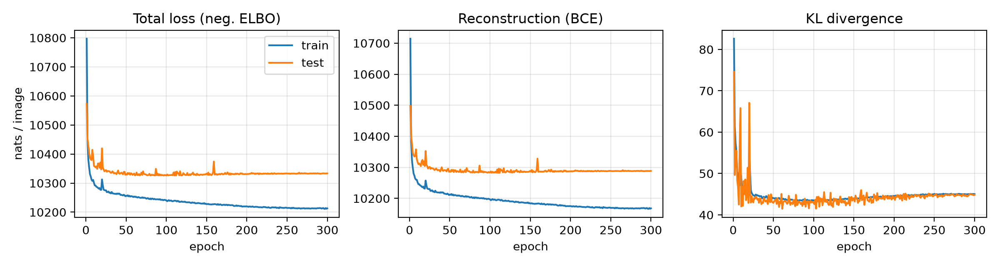
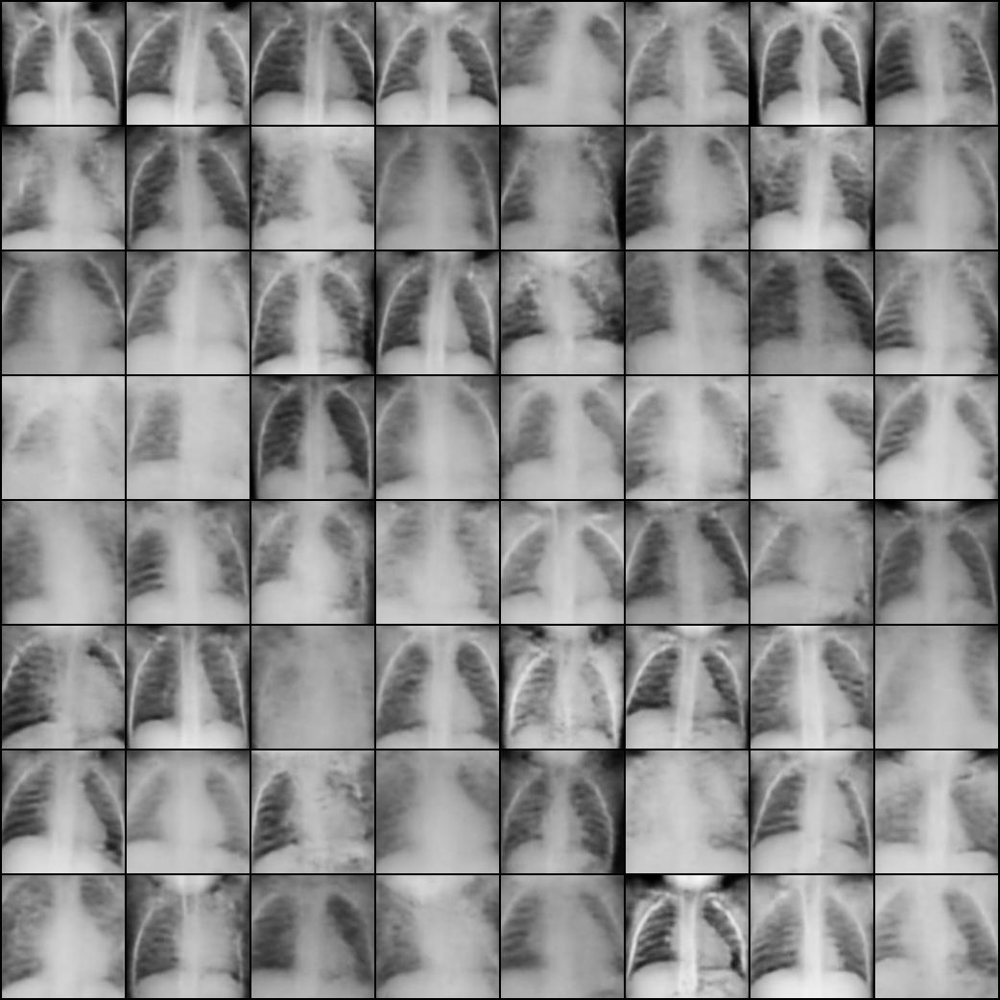
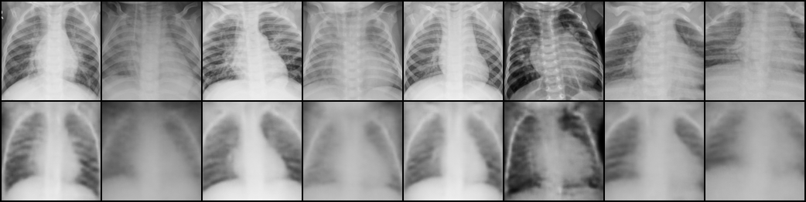
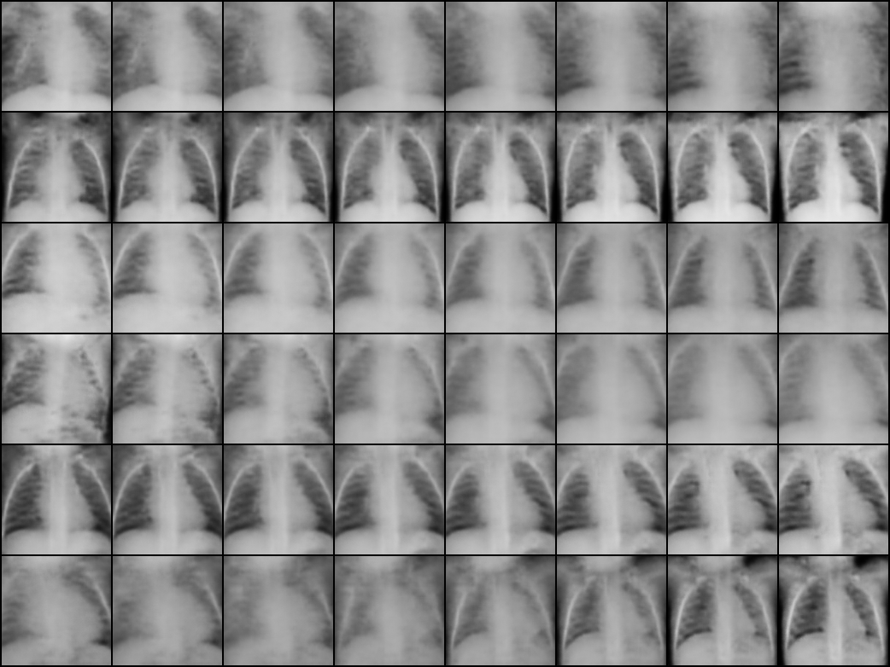

# Chest X-ray VAE

A convolutional variational autoencoder in PyTorch, trained on the
[Kaggle chest X-ray (pneumonia) dataset](https://www.kaggle.com/paultimothymooney/chest-xray-pneumonia)
to generate 128×128 chest radiographs. Generated images are evaluated with Inception Score and FID using
[PyTorch-Ignite](https://pytorch-ignite.ai/blog/gan-evaluation-with-fid-and-is/).

## Files

| File | Purpose |
|---|---|
| `vae.py` | Data loading, VAE model, negative-ELBO loss and training loop |
| `evaluate.py` | FID / IS with `ignite.metrics`, sample, reconstruction and interpolation grids, loss curves |
| `setup_env.sh` | Creates a conda env at a given path and downloads the dataset |
| `run.sh` | Trains for 300 epochs, then evaluates |

## Usage

```bash
ENV=$HOME/envs/vae bash setup_env.sh          # prints the dataset path
DATA=<dataset path>/chest_xray PY=$HOME/envs/vae/bin/python bash run.sh
```

`DATA` must contain `train/`, `val/` and `test/`. Outputs go to `runs/vae/`: `log.csv`, `vae.pt`,
`metrics.json` and `fig_*.png`.

## Model and hyperparameters

- Encoder: five stride-2 4×4 convolutions (32-64-128-256-512 channels) with BatchNorm and LeakyReLU,
  then linear heads for μ and log σ². Decoder mirrors it with transposed convolutions and a sigmoid output.
  8.7M parameters.
- Loss: binary cross-entropy reconstruction + β·KL, with β = 1.
- Latent dim 128, Adam with lr 1e-3 and cosine decay, batch size 64, 300 epochs.
- Training data: all 5,216 training images, grayscale, resized and center-cropped to 128×128.
  The 624 test images are used for monitoring, since the official val split has only 16.

Training takes about 7 minutes on a 24 GB MIG slice of an NVIDIA RTX PRO 6000.

## Results

FID is computed against training images. Ignite's default `FID` uses the 1000-d Inception output, so
the standard 2048-d pool3 FID is reported as well.

| Image set | N | IS ↑ | FID (Ignite default) ↓ | FID (pool3, 2048-d) ↓ |
|---|---|---|---|---|
| VAE samples | 5000 | 1.84 | 0.097 | 173.7 |
| VAE reconstructions of test images | 624 | 1.82 | 0.117 | 171.5 |
| Real test images (reference) | 624 | 2.25 | 0.009 | 23.1 |

Loss curves:



Random samples:



Test images (top) and reconstructions (bottom):



Latent interpolations:


